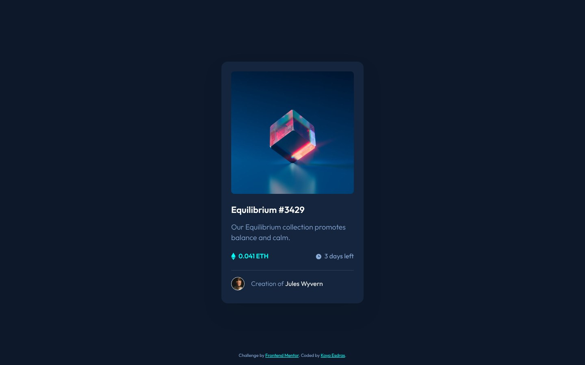

# Frontend Mentor - NFT preview card component solution

This is a solution to the [NFT preview card component challenge on Frontend Mentor](https://www.frontendmentor.io/challenges/nft-preview-card-component-SbdUL_w0U). Frontend Mentor challenges help you improve your coding skills by building realistic projects.

## Table of contents

- [Overview](#overview)
  - [Screenshot](#screenshot)
  - [Links](#links)
- [My process](#my-process)
  - [Built with](#built-with)
  - [Workflow](#workflow)
  - [What I learned](#what-i-learned)
  - [Continued development](#continued-development)
  - [Useful resources](#useful-resources)
  - [AI Collaboration](#ai-collaboration)
- [Author](#author)

## Overview

### Screenshot



### Links

- Solution URL: [frontendmentor.io/solutions/nft-preview-card-component-jwtHXCl0-D](https://www.frontendmentor.io/solutions/nft-preview-card-component-jwtHXCl0-D)
- Live Site URL: [ounokoya.github.io/front-ui-nft](https://ounokoya.github.io/front-ui-nft/)

## My process

### Built with

- Semantic HTML5: an `article` in `main`, the title as an `h1` link, decorative images with an empty `alt`
- One keyboard stop for two links to the same place: the image link is for pointer users only (`tabindex="-1"`, `aria-hidden="true"`), the title is the link for the keyboard and screen readers
- A Cyan overlay with the eye icon on hover, faded in over 200 ms, shown at once with `prefers-reduced-motion`
- [Tailwind CSS v4](https://tailwindcss.com/) — design tokens in `@theme`, default palette removed, a 400 px `sm` breakpoint, named `card-link`, `focus-ring`, `link` and `separator` utilities
- Outfit served with the site through [Fontsource](https://fontsource.org/)
- The attribution in Cyan on the dark page (13.98:1) instead of the starter's blue (2.47:1)
- [Vite](https://vite.dev/) for the build, deployed on GitHub Pages from the `gh-pages` branch (`npm run deploy`)
- [Playwright](https://playwright.dev/), [axe-core](https://github.com/dequelabs/axe-core), the W3C Nu validator, html-validate and ESLint for tests

### Workflow

This is version 2 of my 2023 solution, rebuilt from the current starter in the same repository. Before any code, the design was analysed and rebuilt:

1. **Visual analysis in Excalidraw** — measurements in px, contrast checks, the HTML tree → [`specs/visuel/`](./specs/visuel/)
2. **Penpot mockup** — library, desktop, mobile and tablet screens, visual thresholds calibrated against the design JPGs → [`specs/visuel/penpot/`](./specs/visuel/penpot/)
3. **Spec, then tests** — 22 Given/When/Then scenarios and the accessible names the tests rely on → [`specs/specifications/`](./specs/specifications/); the tests were written before the code and checked to fail on the starter
4. **Decisions** — tokens, fonts, the pointer-only image link and its overlay, the centred card → [`specs/adr/`](./specs/adr/)
5. **Code**, then a walk-through in a real browser → [`specs/analyse/`](./specs/analyse/)

### What I learned

**Two links, one stop.** The image and the title lead to the same page. Two ordinary links would mean two Tab stops and two announcements; taking the image link out of the keyboard order and of the accessibility tree leaves one of each, while the whole image stays clickable:

```html
<a class="group relative block" href="#" tabindex="-1" aria-hidden="true">
  
  <span class="absolute inset-0 grid place-items-center bg-cyan-400/50 opacity-0 transition-opacity duration-200 group-hover:opacity-100 motion-reduce:transition-none">
    
  </span>
</a>
```

**Testing an overlay by its pixels.** The test reads one pixel of the image before and during the hover: during the hover it must be the average of the image and Cyan (50 %), and the centre must be the white of the eye — whatever the markup.

**A fitness function can be fooled by content.** My "no hard-coded colour" check took "Equilibrium #3429" for the colour `#3429`; it now reads only classes, styles and `<style>` blocks.

### Continued development

- **Visual comparison with the design files.** Screenshots differ from the Frontend Mentor JPGs by 0.40 % (desktop), 0.55 % (hover state) and 2.39 % (mobile) of pixels, for a 5 % threshold.
- **Tablet**: my own proposal, the 350 px card centred.

### Useful resources

- [MDN — `aria-hidden`](https://developer.mozilla.org/en-US/docs/Web/Accessibility/ARIA/Reference/Attributes/aria-hidden) — hiding a duplicate link, and why it must not be focusable.
- [MDN — `prefers-reduced-motion`](https://developer.mozilla.org/en-US/docs/Web/CSS/@media/prefers-reduced-motion) — no fade for people who ask for less motion.

### AI Collaboration

I used **Claude (Claude Code)** as a pair, inside my own spec-driven workflow where I validated each step before the next one:

- **Planning**: Claude listed my old solutions that needed a rebuild and wrote the plan, which I validated.
- **Design analysis and mockup**: Claude measured the JPG designs, drew the annotated Excalidraw analysis and built the Penpot mockup; I reviewed both and decided on the links without destinations, the hover overlay, the decorative images, the attribution colours and the tablet layout.
- **Spec and tests**: written by Claude before any code, from the validated mockup.
- **Technical decisions**: fonts from Fontsource, as in my earlier solutions without font files in the starter.
- **Code**: written by Claude from the spec — I confirmed this split at the code lock — with the tests run at each step.

What worked well: comparing the page with the design pixel by pixel explained every difference before it was fixed. What needed my decisions: the choices listed above.

## Author

- Frontend Mentor - [@ounokoya](https://www.frontendmentor.io/profile/ounokoya)
- GitHub - [@ounokoya](https://github.com/ounokoya)
